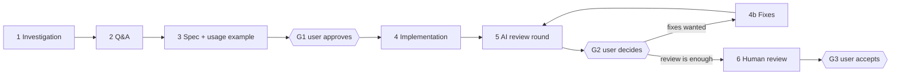

# Phase process (phases 1 to 8)

How each pymarty phase is run. Phase 0 was run differently and is not covered here.
Read this file first, then the role file that applies to you:

| Role | File | Who |
|------|------|-----|
| Orchestrator (also does the Q&A and writes the spec) | [orchestrator.md](orchestrator.md) | the main agent, chosen by the user for the difficulty of the phase |
| Investigator | [investigator.md](investigator.md) | Haiku subagent, read-only |
| Implementer | [implementer.md](implementer.md) | Haiku subagent, one per work package |
| Reviewer | [reviewer.md](reviewer.md) | Haiku subagent, fresh context, read-only except its report |

Subagent model name for `runSubagent`: `Claude Haiku 5.5 (copilot)`. No custom agent files: roles are
plain documents, and a subagent is started with a prompt that points at its role file.

## 1. Steps and gates



| Step | Who | Output (in `docs/architecture/pymarty/phase-N/`) |
|------|-----|--------------------------------------------------|
| 1 Investigation | Haiku investigators, in parallel, read-only | `01-investigation-<topic>.md` (facts with `file:line`) |
| 2 Q&A | main agent with the user | `02-questions.md` (every question, options, recommendation, the user's answer) |
| 3 Spec | main agent | `03-spec.md`, `python/examples/usage/<module>.py`, the updated `phase-N-*.md` plan document |
| 4 Implementation | one Haiku implementer per work package, sequential | code, tests, `04-implementation-log.md` |
| 5 AI review | one fresh Haiku reviewer per round | `05-ai-review-round-<k>.md` |
| 6 Human review | the user | `06-human-review.md` (the user's notes), review pack from the log |

Gates are decisions of the user, and the orchestrator stops at each of them:

- **G1, after step 3.** The user approves the questions and answers, the spec, the usage example and the
  updated plan document. Nothing is implemented before G1. The usage example is the only code written
  earlier (by the main agent, in step 3).
- **G2, after every AI review round.** The orchestrator stops and shows the findings. The user decides which
  findings are fixed, which are dropped (with a reason), and whether another round runs. There is no
  automatic second round.
- **G3, after step 6.** The user accepts the phase. Only then is the next phase started, and always on request.

Nothing is committed or pushed by any agent. The user commits.

## 2. State lives in files

Every step writes its state to a file, so that a new agent can continue without the conversation.
Each file starts with:

```
Status: DRAFT | READY | BLOCKED | APPROVED
Updated: YYYY-MM-DD
Author: <role>
```

`READY` means "finished, waiting for the next step", `BLOCKED` means "needs a decision" (the reason is the
first paragraph), `APPROVED` is set by the orchestrator only after the user said so (with the date).

Rules for all agents:

- Facts are written with `file:line` and, when possible, the command that shows them. An opinion is marked
  as such. A claim that is not verified says "not verified".
- Reports of subagents are not trusted. The orchestrator re-runs the commands and re-reads the lines that a
  decision depends on (see [orchestrator.md](orchestrator.md) section 5).
- The spec is frozen after G1. A change is an amendment at the end of `03-spec.md` (date, what, why, who
  approved) and goes to the user first. The plan document and the spec must not contradict each other.

## 3. Standing rules (copy them into every subagent prompt)

- Do not run the `system` test suite: no `ctest -L system`, no unfiltered `ctest`, no `pytest` without
  `-m "not slow"`. One named system test with `ctest -R <name>` is allowed only to debug it.
  Acceptance is `ctest -L 'units|integration'` plus the `api` and `python` labels (see
  [../testing-strategy.md](../testing-strategy.md)).
- Do not touch `/home/gregoire/marty-public/build` (the user's own build tree). Build outside the repo, in
  `/tmp/pymarty-build` (reconfigure with `cmake .` there; set `CC`, `CXX`, `FC` to GCC 12 explicitly on a
  fresh configure) and use the virtual environment `/tmp/pymarty-venv` for Python.
- Do not commit, push, reset, delete branches or files that are not yours, or edit generated or third party
  content (`build/`, `dep/LoopTools-2.16/`, Doxygen HTML under `docs/doc/`).
- Do not edit reference data in `tests/system/data/output/`.
- Respect the layering: CSL does not depend on MARTY, MARTY does not depend on its plugins. All logic lives in
  C++ (`src/csl/api/`, `src/marty/api/<module>/`), the Python layer is syntax only
  ([../api-conventions.md](../api-conventions.md)).
- `std::cerr` is fine in new code. Distribution questions (wheels, manylinux) are deferred
  ([../distribution-deferred.md](../distribution-deferred.md)).
- Comment only code that needs it. Follow `.clang-format`, `ruff`, `mypy --strict`.
- Prefer short, honest reports: say what was not done and what was not verified.

## 4. Directory layout

```
docs/architecture/pymarty/
  process/                      this folder
  phase-N-<name>.md             the plan document, updated at G1
  phase-N/
    01-investigation-<topic>.md
    02-questions.md
    03-spec.md
    04-implementation-log.md
    05-ai-review-round-<k>.md
    06-human-review.md
python/examples/usage/<module>.py   approved at G1
```

## 5. Phases are sequential

Phases run one at a time in one working tree (shared build directories and sources). Phases 2 and 3 are
independent in the plan, but running them in parallel needs separate git worktrees and build directories and
the user's explicit request. Inside a phase, work packages are sequential too.
